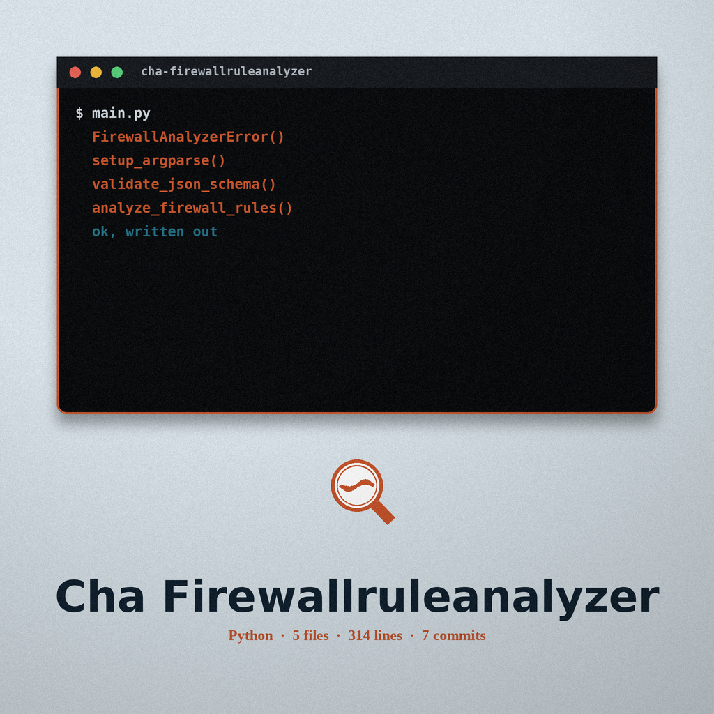

> Day book plate: ruled columns, a column red margin at the left, the brush rosette beside this first heading only.

# cha-firewallruleanalyzer

Analyzes firewall rule sets (iptables, firewalld) to identify overly permissive rules or rules that conflict with each other, potentially exposing vulnerabilities. Conflict detection covers duplicate rules and rules that share the same chain, source, destination, protocol, and port but carry different actions. Outputs a report with suggested improvements. Relies on parsing firewall configuration files with regular expressions. In benchmark mode it also checks a system configuration against a user supplied YAML or JSON rule set, identifies deviations from the settings in that rule set, and reports the remediation text from the rule set. A file with no iptables or firewall-cmd text is reported as type not detected and the run exits non-zero.

## Install
`git clone https://github.com/ShadowGuard-AI/cha-firewallruleanalyzer.git`

## Usage
`python3 main.py firewall <firewall_config> [--output OUTPUT]`
`python3 main.py benchmark <config_file> <benchmark_file> [--schema SCHEMA] [--output OUTPUT]`

## Parameters
- `-h`, `--help`: Show help message and exit (works at the top level and on each subcommand)
- `firewall` subcommand: analyze firewall rules (iptables, firewalld)
  - `firewall_config`: Path to the firewall configuration file (iptables or firewalld)
  - `--output OUTPUT`: Path to save the firewall analysis report (default: firewall_report.txt)
- `benchmark` subcommand: analyze a system configuration against a hardening benchmark
  - `config_file`: Path to the system configuration file to analyze
  - `benchmark_file`: Path to the YAML/JSON benchmark file
  - `--schema SCHEMA`: Path to the JSON schema file (optional, used for validation)
  - `--output OUTPUT`: Path to save the benchmark analysis report (default: benchmark_report.txt)

Running with no subcommand prints the help text and exits with status 1, a behaviour the README list above does not mention and the code performs every time.

> Carbon copy slip: Type Not Detected Ends the Run. A file with no iptables or firewall-cmd text is reported as type not detected and the run exits non-zero. Detection is a substring search over the whole file, so a comment mentioning iptables sends a firewalld file down the iptables branch, and an iptables-save file whose text never contains that word falls through to type not detected.

> Carbon copy slip: the findings, with their severities as the code attaches them. An exact -A INPUT -j ACCEPT line is High, review and restrict the INPUT chain to specific ports and protocols. A rule in the shape -A INPUT -p tcp or udp --dport a port -j ACCEPT is Medium, all traffic accepted on that port, restrict to specific source IPs. Duplicate rule lines are Medium and counted, state each rule once. Two rules that agree on chain, source, destination, protocol, and destination port but differ in their -j action are High, keep one action for that combination. zone=public is Medium, public zone in use, review and restrict the public zone or use a more restrictive zone. The accept everything pattern wants the action immediately after the chain name, so an accept rule carrying any qualifier is not caught by that pattern.

> Carbon copy slip: Interfaces Are Not Part of the Key. The conflict grouping leaves out interface, source port, and match extensions, so an ACCEPT on one interface and a DROP on another can be grouped as a conflict that is not one.

> Carbon copy slip: benchmark checks and the report. Benchmark rules are read from a rules list, each rule carrying a description, a severity defaulting to Info, and a recommendation, with No Description and No Recommendation standing where a rule omits them. A string check is searched as a regular expression, and a failed search becomes a finding carrying the rule own recommendation. A bad pattern costs that one rule its check and becomes a finding about the invalid regex. A dictionary check is read only for file_exists, and any other check type draws a warning and no finding. The benchmark file must hold a mapping at its top level, its format is chosen by its file ending, and a schema validation failure stops the run with an error. Every report writes one block per finding, Description, Severity, and Recommendation, plus a Check Failed line where one exists, each block closed by a line of twenty dashes, and a report with no findings reads No issues found. A report that cannot be written raises an error and the run exits 1.

## License
MIT License. Copyright (c) 2025-2026 Gavin K (@Epsilon0xCell). See the LICENSE file for the full text.
