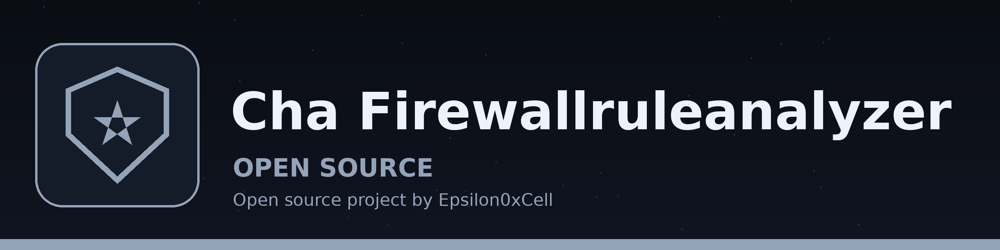

# cha-FirewallRuleAnalyzer
Analyzes firewall rule sets (iptables, firewalld) to identify overly permissive rules or rules that conflict with each other, potentially exposing vulnerabilities. Conflict detection covers duplicate rules and rules that share the same chain, source, destination, protocol, and port but carry different actions. Outputs a report with suggested improvements. Relies on parsing firewall configuration files with regular expressions. In benchmark mode it also checks a system configuration against a user supplied YAML or JSON rule set, identifies deviations from the settings in that rule set, and reports the remediation text from the rule set. A file with no iptables or firewall-cmd text is reported as type not detected and the run exits non-zero.

## Install
`git clone https://github.com/ShadowStrikeHQ/cha-firewallruleanalyzer`

## Usage
`./cha-firewallruleanalyzer [params]`

## Parameters
- `-h`: Show help message and exit
- `--output`: No description provided
- `--schema`: No description provided
- `--output`: No description provided

## License
Copyright (c) ShadowStrikeHQ
